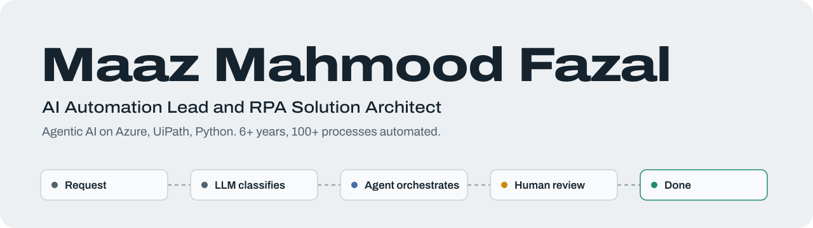
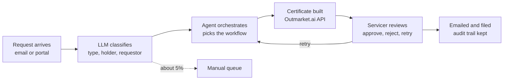

<picture>
  <source media="(prefers-color-scheme: dark)" srcset="assets/banner-dark.svg">
  <source media="(prefers-color-scheme: light)" srcset="assets/banner-light.svg">
  
</picture>

**[Portfolio site](https://necromancer14.github.io/maazmahmoodfazal-portfolio/)** | [LinkedIn](https://www.linkedin.com/in/maaz-mahmood-fazal) | [maaz.mahmood1999@gmail.com](mailto:maaz.mahmood1999@gmail.com) | Jeddah, Saudi Arabia

**AI Agents & Automation Architect.** I design and deliver LLM agents that do real operations work: certificates of insurance, telecom orders, SAP invoices and donation records. I keep a person in the loop where it matters and route what the agent can't handle. Over six years I have taken more than 100 business processes from manual to automated, starting with RPA on UiPath and now with agents on Azure.

I'm looking for AI automation and solution architect roles in Saudi Arabia, the UAE and Europe. I hold a transferable iqama.

## The agent I run in production

A certificate of insurance agent for a US insurance client, built at Oz on Azure AI Foundry. About **95%** of requests complete through the agent, and a person approves every certificate before it goes out. [Full write-up](projects/COI_Agent/README.md)

Runs on Azure Service Bus, Cosmos DB for the audit trail, Blob Storage for the PDFs, and managed identities between services.

## Public code

Client work sits behind security, so this is the code I can show.

**[feedback-agent](https://github.com/Necromancer14/feedback-agent)**: a help-desk agent that answers from a knowledge base, abstains when nothing fits, and learns from thumbs up, thumbs down and corrections. It has 19 tests and a cross-validated evaluation, and the README reports the result as it came out.

| Top-1 correct | No feedback | After feedback |
|---|---|---|
| Unseen questions (4-fold) | 84% | 84% |
| Same questions asked again | 84% | 100% |

## Delivery at Oz

Insurance and healthcare automation for a US client, with HIPAA-compliant handling of PHI. Feb 2026 to present.

| Project | What it does | Result |
|---|---|---|
| [Certificate of insurance agent](projects/COI_Agent/README.md) | LLM classification, API orchestration, human approval | 95% of requests through the agent |
| [Email Procedure Bot](projects/Email_Procedure_Bot/README.md) | Reads emails and creates structured tasks | 70% less triage effort, 60% fewer errors |
| Auto ID Card Generation | Policy data to compliant insurance ID cards | 85% faster issuance |
| Endorsements Bot | Vehicle add and remove, then ID cards downstream | 80% faster processing |
| Health Plan Notice Bot | HIPAA-compliant notices from policy updates | 75% faster, 65% fewer compliance errors |
| Alert on Variance Report | Flags expiring policies, creates follow-up tasks | 90% fewer missed follow-ups |
| Release pipelines | Azure DevOps CI/CD and staged releases for every bot | 30% less deployment effort |

## Delivery at HachiAi

Telecom, logistics, finance, eCommerce and nonprofit clients. Nov 2020 to Feb 2026.

| Project | What it does | Result |
|---|---|---|
| [TELUS Business Connect](projects/TELUS_Business_Connect/README.md) | Telecom order processing through APIs | 70% to 97% efficiency, 15 to 3 minutes per order |
| [Distrivalto](projects/Distrivalto_SAP_Automation/README.md) | SAP orders, invoices and tracking with Gemini and MCP | 90% process efficiency |
| [IDRF](projects/IDRF_LLM_Automation/README.md) | Donation data with LLM field mapping | 42% better data accuracy |
| [Logistics Alliance](projects/Logistics_Alliance/README.md) | Shipment data posted by REST API | 40+ hours saved a week |
| CellNTell | Repricing on Amazon, Walmart and Best Buy | 33% higher profit |
| Naylor | Invoice validation and reconciliation | 30% fewer processing delays |
| [ATS](projects/ATS_Booking_Automation/README.md) | Appointment booking in the C3 portal | 85% less manual booking |

## Experience

| Dates | Role | Company |
|---|---|---|
| Feb 2026 to present | AI Automation Consultant and RPA Solution Architect | Oz |
| Nov 2023 to Feb 2026 | AI Automation Lead and RPA Solution Architect | HachiAi, Canada |
| Nov 2022 to Nov 2023 | Senior RPA Developer | HachiAi, Canada |
| Nov 2020 to Nov 2022 | RPA Developer, joined as an intern | HachiAi, Canada |

## What I work with

- **Agents and LLMs:** Azure AI Foundry, OpenAI and Gemini APIs, MCP tool calling, RAG and vector search, UiPath Agentic Automation
- **Automation:** UiPath (REFramework, Orchestrator), Power Automate, Automation Anywhere, n8n, document processing
- **Azure and DevOps:** Azure DevOps CI/CD, Service Bus, Cosmos DB, Blob Storage, managed identities, GitHub Actions, Docker, Git
- **Languages:** Python, SQL, VB.NET, PowerShell, REST APIs

## Certifications and education

- UiPath Automation Developer Associate
- Microsoft Power Automate RPA Developer
- Advanced REFramework Implementation (UiPath)
- Python for Automation
- BS Software Engineering, Punjab University College of Information Technology, Lahore, 2016 to 2020

Languages: English (fluent), Arabic (conversational), Urdu (native).
