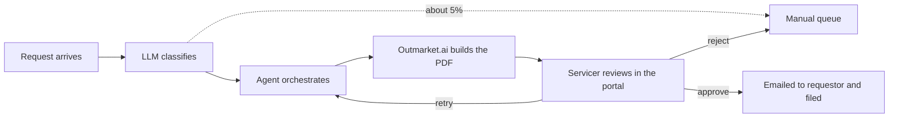

# Certificate of insurance agent

Oz, for a US insurance client. 2026. Built on Azure AI Foundry.

[Back to portfolio](../../README.md)

## Problem

Servicers handled every certificate of insurance request by hand: read the email, work out what was being asked, build the certificate, send it and file it.

## What I built

An agent that does the routine part and leaves the approval with a person.

1. An LLM reads each request and classifies its type, holder and requestor.
2. The agent calls the matching Outmarket.ai workflow through its API to generate the certificate as a PDF.
3. A servicer logs in to the portal, sees each intake run and the generated PDF, and approves, rejects or retries it.
4. Approved certificates are emailed to the requestor and filed in the document system.

## Design decisions

- **The LLM decides what is asked, not what the certificate says.** The certificate is built by the matching Outmarket.ai workflow, so the model never writes coverage details.
- **A person approves every certificate.** A wrong certificate goes to a third party, so the agent prepares the work and a servicer signs it off.
- **Unclear requests go to people instead of a guess.** If the agent cannot place a request, it goes to a manual queue.
- **Queued, logged and keyless.** Work moves through Service Bus so nothing is lost during spikes or retries, every step is written to Cosmos DB, and services authenticate with managed identities instead of stored secrets.

## When it fails

- Requests the agent cannot place go to the manual queue. That is about 5% today.
- A servicer can retry a run with changes, which sends it back through orchestration, or reject it to the manual queue.

## Platform

| Concern | Service |
|---|---|
| Queueing work | Azure Service Bus |
| Audit trail | Cosmos DB |
| PDFs and attachments | Blob Storage |
| Access between services | Managed identities |
| Models and agent | Azure AI Foundry |

## Result

- About **95%** of requests complete through the agent.
- The other 5% go to a manual queue. Phase 2 is planned to cover them.
- Every certificate still gets a human approval, and every step is in the audit trail.

## My role

Designed the architecture and led delivery with the client team. Built with Cursor.
